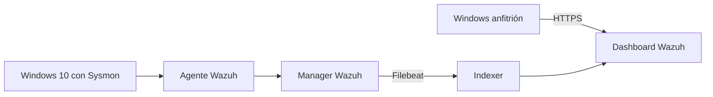
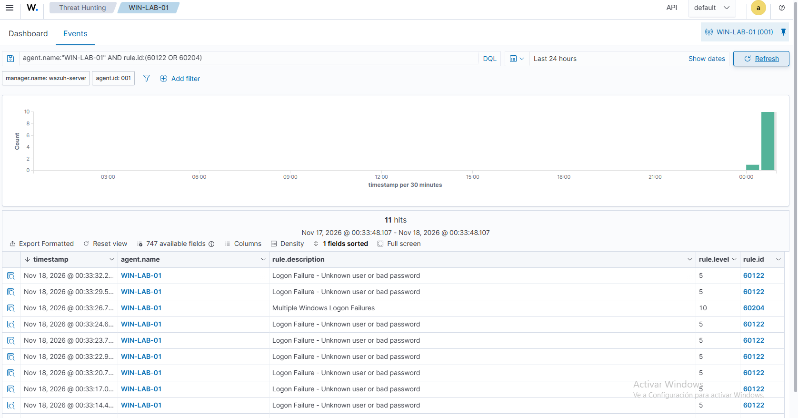
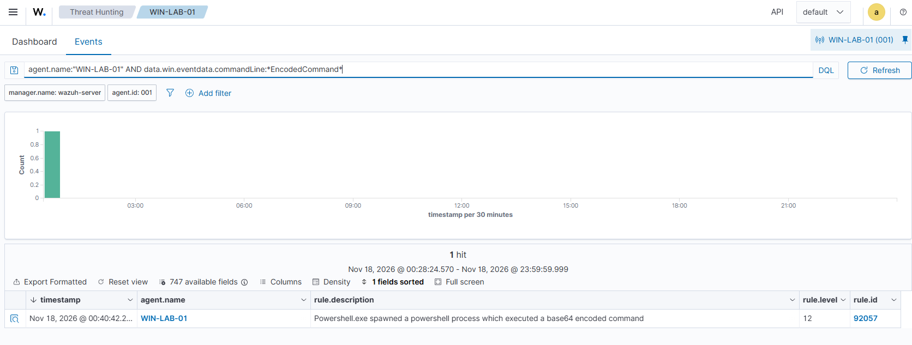

# Laboratorio Blue Team con Wazuh y Sysmon

Investigué alertas de un endpoint Windows 10 virtualizado y validé dos detecciones de Wazuh 4.14.10. Usé VirtualBox para alojar el endpoint y el servidor Wazuh. Durante las pruebas, Windows Security registró las autenticaciones y Sysmon registró la creación de procesos y archivos.

## Arquitectura y preparación



VirtualBox aloja dos VM. La OVA de Wazuh reúne los componentes centrales. En la VM Windows instalé el agente, lo registré como `WIN-LAB-01` y comprobé su estado activo. Habilité la lectura del canal `Microsoft-Windows-Sysmon/Operational` como `eventchannel` y verifiqué la auditoría de fallos de inicio de sesión en el canal Security. La [configuración de Sysmon](sysmon-lab.xml) recoge creación de procesos, conexiones de red y creación de archivos.

## Cómo investigué las pruebas

En Threat Hunting usé estas consultas, acotando el tiempo a cada prueba:

```text
agent.name:"WIN-LAB-01" AND rule.id:(60122 OR 60204)
agent.name:"WIN-LAB-01" AND data.win.eventdata.commandLine:*EncodedCommand*
```

Para autenticaciones comparé la cuenta, el origen y la hora de los fallos con el registro Security. Para PowerShell relacioné el padre y el hijo con el archivo de texto que creó la prueba. La primera captura abarca 24 horas: sus 11 resultados incluyen actividad anterior a la última secuencia.

## Resultados

| Prueba | Evidencia observada | Decisión |
| --- | --- | --- |
| Fallos de autenticación en la VM | Windows registró eventos 4625. En Wazuh aparecieron la regla individual 60122 (nivel 5) y la correlación 60204 (nivel 10). | Conservar la correlación incorporada. Ante un caso real, revisar origen, cuenta y accesos exitosos posteriores. |
| PowerShell codificado | Sysmon registró un proceso PowerShell hijo de otro PowerShell. Wazuh detectó el argumento codificado con la regla 92057 (nivel 12, T1059.001). El comando de laboratorio escribió un texto conocido. | Clasificar como verdadero positivo de prueba. Para una alerta desconocida, inspeccionar el contenido codificado como texto y revisar sus efectos. |





## Investigación y ajuste de reglas

En la validación inicial observé 28 resultados al filtrar por el agente y el canal de Sysmon. En otra sesión, durante 15 minutos de uso cotidiano, la consulta de todas las alertas del endpoint mostró 1460 resultados. Las consultas tenían alcances distintos. Entre ambas sesiones investigué tres casos para evaluar si convenía reducir el ruido.

- **92201, script temporal.** El identificador del proceso vinculó la creación de un archivo de prueba de política de PowerShell con una instancia que también inició SecEdit para consultar la política de bloqueo. El directorio de trabajo apuntaba al agente Wazuh. La atribución al agente es probable.
- **92213, archivo temporal de Edge.** Sysmon identificó a Edge como creador de un archivo llamado manifest.json. El proceso también inició un renderer. La firma del binario era válida y el archivo ya estaba ausente al revisarlo. El conjunto es compatible con actividad normal del navegador. El contenido del archivo quedó sin verificar.
- **92217, DLL bajo Windows.** Para el evento investigado, el mismo identificador de proceso vinculó la creación de System.Xml.dll bajo NativeImages con el optimizador de .NET iniciado por ngen.exe. La firma del optimizador era válida. El veredicto benigno corresponde a ese evento individual.

Conservé las reglas originales. Una exclusión de todo PowerShell, Edge o las carpetas temporales también ocultaría eventos fuera de los patrones revisados. Para justificar un ajuste futuro mediría la frecuencia por proceso, padre y ruta de destino durante varias sesiones.

## Análisis de autenticaciones fallidas

**Validación de los fallos de acceso.** La primera prueba con `runas` devolvió un error al obtener la contraseña. La consulta al registro Security devolvió cero eventos 4625 en la ventana examinada. Comprobé con `auditpol` que la auditoría de errores ya estaba habilitada. En la prueba posterior de autenticación de red contra la propia VM, conté cinco eventos locales y cinco alertas individuales en Wazuh. El detalle del evento mostró NTLM, inicio de sesión tipo 3, origen loopback y subestado `0xc000006a` para la cuenta de prueba.

**Del evento individual a la correlación.** Revisé la definición instalada de la regla 60204 en el manager. Indicaba frecuencia 8 y ventana de 240 segundos. Durante las repeticiones Windows bloqueó la cuenta de prueba y devolvió el error 1909. La prueba final con un nombre de usuario inexistente produjo la alerta de nivel 10. Esto permitió validar la detección incorporada y conservar la política de bloqueo.

## Alcance

Las pruebas se realizaron dentro de WIN-LAB-01. Las capturas muestran el alias del equipo de laboratorio. Los resultados documentan el comportamiento observado en esta configuración y en esas ventanas de tiempo.
